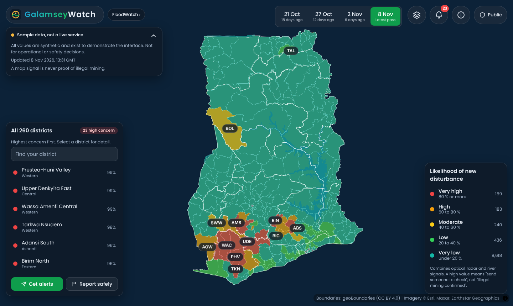
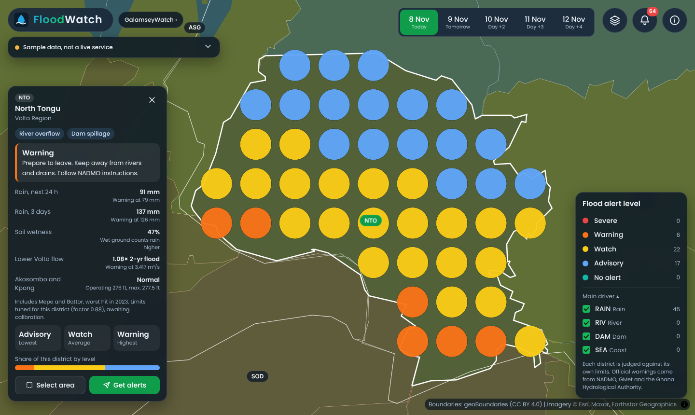

# GalamseyWatch and FloodWatch Ghana

Two separate early-warning tools for Ghana that share one codebase and one look, modelled on the BloomLine dashboard.

| Tool | Purpose | Open it |
|---|---|---|
| **GalamseyWatch** | Spots new land disturbance and muddy rivers, then sends each signal to a person to check | `galamsey/` |
| **FloodWatch** | Checks each district against its own limits for rain, rivers, dams and the sea | `flood/` |

> **Every value on the maps is synthetic.** District boundaries, river systems, intake names, flood-prone places and dam reference levels are real. No score, alert, case or status is. A satellite signal cannot show whether mining is legal. Official flood warnings come from NADMO, GMet and the Ghana Hydrological Authority.




## What works

**Both tools**
- National map of all 260 districts in the source data, with a "find your district" search
- BloomLine layout: dated tabs, layer menu, alert bell, colour legend, district view with value dots, drag-to-select trend
- Alert sign-up preview for SMS, WhatsApp, voice and app
- Works on phones and can be installed from the browser, with the last-viewed data kept for weak connections
- Shareable links for any view

**GalamseyWatch**
- 30 priority districts across the Offin, Pra, Ankobra, Tano, Birim and Ayensu systems, and northern sites
- Layers: mining disturbance, vegetation loss, river muddiness, radar change, water intakes
- A filter showing which satellite saw each cell, so cloud gaps stay visible
- **Public view:** 5 km cells only. **Agency view:** 1.5 km cells and a case queue with evidence and review actions
- Safe anonymous reporting form (demo only)

**FloodWatch**
- 55 named flood-prone districts with hand-set rules; the other 205 use a regional default
- Layers: flood alert, rain, river pressure, soil wetness, dams and spillage
- Each district explains its level: which driver, its value and the limit it crossed, plus what to do

## Run it

```bash
python3 -m http.server 8000
# open http://localhost:8000
```

## Publish on GitHub

Create an empty repository named `galamseywatch-ghana`, then from this folder:

```bash
git init -b main
git add .
git commit -m "GalamseyWatch and FloodWatch Ghana prototype"
git remote add origin https://github.com/YOUR-USERNAME/galamseywatch-ghana.git
git push -u origin main
```

Then go to **Settings → Pages → Deploy from a branch → `main` / `(root)`**.

## Turn on open flood data

`tools/fetch_flood_live.py` replaces FloodWatch samples with GloFAS v4 river forecasts, rainfall, soil moisture and waves from Open-Meteo. To run it every six hours, add the repository variable `FLOOD_LIVE` with the value `true`. The first run also builds each river point's flood thresholds from 1984 onwards.

Read `docs/FLOOD_METHOD.md` first. District limits are starting values, so the output must not be presented as a warning. Open-Meteo's free tier is for non-commercial use.

## Layout

```
index.html              landing page
galamsey/ flood/        the two tools
app/                    shared map, panels and controller
data/shared/            real boundaries
data/galamsey|flood/    data the tools read (samples for now)
tools/                  sample generator, flood rules, live fetcher, validator
pipeline/gee/           Earth Engine screening script
docs/                   architecture, methods, data contract, sources
tests/smoke.py          browser test
```

Replacing samples means writing the same files. See `docs/DATA_CONTRACT.md`.

## Check it

```bash
pip install -r tools/requirements.txt playwright
python3 tools/validate_data.py
python3 tests/smoke.py
```

## Before any public launch

1. Agree data access and sign-off with NADMO, GMet, Ghana Hydro, the Minerals Commission, the EPA and the Water Resources Commission.
2. Move the agency view behind real sign-in. Today its sample files are public, which is only acceptable because they are invented.
3. Review the priority lists with national agencies. They are screening lists, not allegations.
4. Have alert wording checked and translated by people, including Twi, Ewe, Ga, Dagbani and Hausa.
