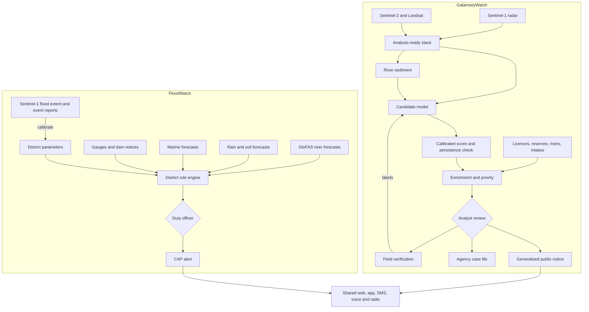

# Architecture

## Review of the proposed design

The attached design has the right building blocks: free satellite data, preprocessing, an AI detector, a warning engine and a public platform. I would keep those and change seven things.

| # | In the proposal | Problem | Change |
|---|---|---|---|
| 1 | One chain runs from AI mining detection to river monitoring and flood vulnerability | A mining model cannot produce a flood forecast. Flood timing depends on rain, rivers, dams and terrain | Two independent chains. Mining may later add a slow-moving vulnerability input to flood risk, but never triggers a flood alert |
| 2 | River monitoring sits after mining detection | Muddy water can appear before a site is visible, and helps locate activity upstream | River sediment becomes an input that feeds detection |
| 3 | Planet NICFI as an input | That programme's phase ended in 2025, and Planet imagery left Global Forest Watch that April | Nothing depends on it. Use Sentinel for detection and buy high-resolution imagery only to verify priority cases |
| 4 | Detection goes straight to alerts | False accusations and dangerous interventions | Add analyst review, licence and reserve checks and field verification |
| 5 | Everyone gets the same output | Exact coordinates can endanger people and tip off operators | Public 5 km view, agency detail behind sign-in, separated on the server |
| 6 | No feedback path | The model cannot improve | Each review decision becomes a training label |
| 7 | One public web and mobile endpoint | Mobile data and app use exclude many rural users | Add SMS, voice, community radio and CAP feeds, issued through official channels |

The latency note in the proposal is correct and should stay: detection follows each usable image. Sentinel-1 has been back to a six-day repeat with Sentinel-1C and 1D since 24 June 2026.

## Recommended design

## Production components

| Layer | Prototype | Production |
|---|---|---|
| Processing | GitHub Actions, Earth Engine script | Scheduled workers on Copernicus Data Space or Earth Engine, GPU inference, stored scene provenance |
| Storage | Static JSON | PostGIS, cloud-optimised rasters, object storage |
| Public API | Static files | Read-only API that receives only approved, generalised records |
| Agency | Sample records | Sign-in, roles, audit trail, encryption and retention rules |
| Delivery | Preview | CAP 1.2 feed, SMS and voice gateway, delivery receipts |

GMet reported operating the Common Alerting Protocol in 2025, so CAP is the natural way to connect to the national warning chain.

## Phases

| Phase | Time | Outcome |
|---|---|---|
| 0 Prototype | Done | This repository |
| 1 Data and partners | Months 1 to 3 | Agreements, licence and reserve layers, first flood data live for partners |
| 2 Pilot | Months 4 to 9 | Pra and Offin mining pilot; Accra, White Volta and Lower Volta flood pilot |
| 3 Validation | Months 10 to 15 | Published skill scores; alerts issued with partner sign-off |
| 4 National service | Months 16 to 24 | All districts, multi-language alerts and handover to a Ghanaian host |
